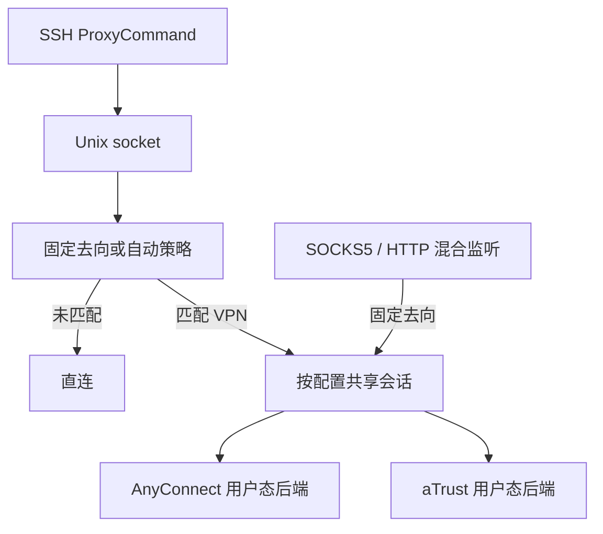

# 原生会话设计

一个 Go 二进制提供前台 SSH ProxyCommand 和后台会话服务。原生版不兼容旧版外部 OpenConnect CLI 的配置与命令。入口位于 `cmd/och/main.go`，实现按职责放在 `internal/`。

## 代码组织

| 路径 | 职责 |
| --- | --- |
| `cmd/och` | 调用 CLI，打印错误并设置退出码。 |
| `internal/browser` | 专用浏览器启动、CAS 回调捕获与临时配置清理。 |
| `internal/cli` | 命令参数、配置选择和服务调用。 |
| `internal/authstate` | 私有、身份绑定的认证状态与进程间独占锁。 |
| `internal/discovery` | 无凭据的 HTTPS 认证方式发现。 |
| `internal/setup` | 首次配置、认证、证书确认与可选 SSH 配置。 |
| `internal/service` | 私有后台启动及 launchd/systemd 用户服务。 |
| `internal/config` | YAML 类型、解析和校验，不依赖运行时服务。 |
| `internal/routing` | 有序域名/CIDR 规则、解析及连接选择。 |
| `internal/vpn` | 共享会话、原生 AnyConnect/aTrust 后端和用户态网络栈。 |
| `internal/proxy` | 混合协议入口、缓冲连接和双向数据转发。 |
| `internal/daemon` | Unix socket 协议、客户端、监听和服务生命周期。 |
| `tests` | 真实编译产物的 CLI 集成检查。 |

配置是叶子包。routing 和 proxy 各自声明所需的拨号接口，由 vpn.Manager 实现；它们不需要导入 VPN 后端。daemon 组装运行时组件，cli 选择配置并调用 daemon。AnyConnect 与 aTrust 暂时保留在同一个 vpn 包，避免引入没有独立用途的协议子包。

包内测试随实现移动。涉及混合监听与 IPC 的跨包旅程保留在 daemon 的集成测试中，原生网络栈测试留在 vpn。

## 选择与取舍

比较过两个入口方案。让 SSH 连接本地 SOCKS 端口可以复用代理协议，但固定去向和自动策略需要额外端口或非标准认证字段。最终选择 Unix socket 作为本地控制与数据通道，mixed TCP 监听只负责标准 SOCKS5/HTTP 导出。

`serve` 可显式运行；`setup` 可启动新后台并注册用户服务，启动后通过 Ensure 验证认证恢复。每个 VPN 配置独立维护惰性会话，首个连接触发认证，同一配置的并发请求共享初始化。首版保留会话到服务退出，不提供空闲超时回收。终止的会话标记为 failed，后续请求在五秒冷却后重新初始化。普通目标端口连接失败不会销毁健康隧道。地址配置改变时旧用户态栈失效并需重建，不承诺恢复既有 SSH/TCP 流。

## 数据流

固定监听收到请求后不再应用 SSH 分流策略。用户可将该端口配置为 sing-box 等工具的上游代理，由调用方负责分流。打开代理端口本身不接管系统流量。

## 连接契约

内部后端提供 `DialContext(context.Context, network, address) (net.Conn, error)` 与 `Close() error`。VPN 协议不接触 CLI 或策略。后端不能在连接失败后转为本机直连。

SSH 自动策略按规则顺序匹配域名、域名后缀或 CIDR，未匹配直连。域名后缀匹配必须具有标签边界。CIDR 匹配时解析出的目标 IP 必须用于实际拨号，避免第二次解析改变目的地址。固定去向的域名交给 VPN 后端解析。Fake IP 映射不在首版范围。

SOCKS5 仅提供 TCP CONNECT。HTTP 支持 CONNECT 和普通 HTTP 代理请求。所有监听限制到本机回环地址。Unix socket 使用私有目录和文件权限，不输出凭据。SSH stdout 只传数据，错误与诊断使用 stderr。

## 验证边界

隔离测试通过替身 session 工厂与真实本地 TCP/HTTP 服务验证会话并发、路由、协议和 IPC；不使用真实 VPN 凭据、不创建系统 TUN、不修改路由或个人 SSH 配置。协议库编译通过不等于高校网关认证通过。具体结果和未覆盖项见验证技能及 Feature Map。

## CAS 登录

`och login --via NAME` 与后台通过私有 Unix socket 交换登录挑战。浏览器只由前台命令启动，后台完成认证后把会话放入现有共享池。登录请求取消不会关闭其他配置的会话，成功会话也不随前台登录命令结束而关闭。

专用 Chromium 配置通过 loopback DevTools 在 CAS 回调发送前中止请求，确认中止后再把一次性回调交给后台。两端都检查网关 origin、路径、登录域和 ticket 唯一性。后台只向客户端返回固定错误类别和数字状态码，不回显 ticket-bearing URL。配置 auth_state_file 后，OCH 会保存可复用的原生认证状态，后台重启优先恢复。`--remember` 另行保留私有浏览器配置中的学校 SSO 状态，用于缓存失效后减少交互。浏览器目录受当前用户权限和独占锁保护。

对使用 IP 节点但签发 DNS 证书的部署，可显式配置 aTrust 的 tunnel_server_name。它只改变数据通道的 TLS 服务名称，仍验证证书链，不改变浏览器或 HTTPS 认证端点的名称校验。

`tunnel_certificate_file` 可以是明确确认的多证书 PEM 集合。加载时去重并拒绝非证书内容。节点探测与隧道只接受集合内的精确叶证书，仍执行名称、有效期和用途检查；没有自动信任新节点证书的路径。

## 首次使用与持久化

Bootstrap 在前台完成一次认证，将可复用状态写入私有状态文件，再处理必要的私有通道证书确认。认证状态先保存，证书拒绝或网络失败不会迫使用户重新登录。完成后关闭前台会话并释放文件锁，由新后台进程读取同一状态恢复，并通过 Ensure 验证。

状态采用权限保护而非加密：当前用户拥有的 0700 父目录、0600 常规文件、符号链接拒绝、网关/协议/认证域/账号/认证组绑定、原子替换和目录同步。会话生命周期内持有独占锁，刷新写入不能与另一进程竞争。Logout 先停止初始化/活动流/刷新，再删除状态，并阻止清理期间重新初始化。

AnyConnect 的本地 sing-openconnect 补丁只增加成功认证 cookie 的回调；aTrust 使用其客户端状态接口，并在认证成功后、隧道建立前保存。没有把密码或一次性 CAS 回调写入缓存。服务端拒绝过期状态时要求登录，普通网络故障保留状态。
